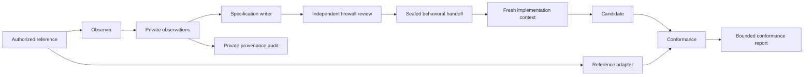

# Independent Reconstruction

Build original software from observable behavior and inspectable evidence.

This local agent package combines focused skills, role prompts, commands, rules,
host hooks and a modular Python runtime. It supports compatibility research for
libraries, APIs, stateful protocols, binaries, file formats and language ports.
It does not automatically remove licenses, attribution or source-disclosure duties.

## Start a workflow

Invoke `$ir-orchestrate` after the skills are discovered in a new agent session.
Give it the target, interface, language, authorized evidence and compatibility goal.
It selects the relevant roles and scenario skills. Each skill is explicit invocation
only, so unrelated sessions do not adopt reconstruction rules.

For an inventory, read [skills](skills/README.md), [commands](commands/README.md)
and [scenarios](docs/scenarios/README.md). Commands are agent procedures. The CLI
performs the evidence and artifact operations those procedures use.

```bash
python3 /home/brunner56/plugins/independent-reconstruction/scripts/ir.py --help
python3 /home/brunner56/plugins/independent-reconstruction/scripts/ir.py init /home/brunner56/ir-runs/example --target counter-protocol --language Python
```

Use a private run outside the reference checkout. Reference roots can be registered
with repeated `--source-root` arguments. Registration does not grant access rights.

## Follow the evidence



The five primary responsibilities are observer, specification writer, firewall
reviewer, implementer and conformance reviewer. Coordinator, provenance auditor,
contamination responder and release reviewer handle cross-cutting work.

## Use the runtime

| Command | Operation |
| --- | --- |
| `init` | Create owner-only evidence storage and source-root policy |
| `observe` / `probe` | Register classified evidence or capture JSON adapter observations |
| `check` | Validate contract structure, provenance references and obvious leaks |
| `digest` / `approve` / `approve-cases` | Bind specification and corpus reviews to exact bytes |
| `handoff` / `packet` | Seal a source-free workspace and create a launch packet |
| `session` | Record provider, model, context, exposure and training uncertainty |
| `sandbox` | Launch a tool with bubblewrap, no host home and no network |
| `validate` | Compare reference and candidate JSON adapters against declared cases |
| `audit` / `resume` | Check artifact hashes, policy and handoff integrity |
| `status` / `report` | Report coverage, candidate staleness and limitations |
| `incident` | Quarantine a contaminated run without deleting its work |
| `scan` | Inventory npm, Cargo, PyPI or Go declarations without downloading |
| `compare` | Compute a bounded textual similarity signal without source excerpts |
| `export` | Produce a report bundle that excludes private evidence |

Use `<command> --help` for exact arguments. Examples and JSON schemas live in
[examples](examples/) and [schemas](schemas/). See [quickstart](docs/quickstart.md)
for the full process and [adapter contract](docs/adapters.md) for conformance.

## Install into an agent

Personal skills are linked from `~/.agents/skills/` to this canonical package.
That makes them available to compatible hosts after skill rediscovery. It does
not install global enforcement hooks or make the current session source-free.

The project installer prepares a package snapshot and merges only its host
configuration entries. Run its help for supported host options:

```bash
python3 scripts/install.py --help
```

Native manifests are included for Codex, Cursor and Claude. Host support varies;
read [integration notes](integrations/README.md). A command hook can be exercised
through its JSON stdin interface independently of host loading. Actual loading,
trust decisions and end-to-end model execution are separate claims.

## Assess the limits

The firewall is conservative screening plus an explicit review. It cannot prove
that a plausible requirement contains no protected expression. Reviewer identity
and fresh contexts are attestations. Model training exposure usually remains unknown.

The ledger is hash-chained and content-addressed. It catches inconsistent local
changes; its owner can rewrite an entire chain. External timestamps or independent
anchors are needed for stronger evidence. Candidate hashes cover recorded files,
not every dynamically loaded dependency or host configuration.

Bubblewrap provides a local process boundary on Linux. System runtime directories
remain trusted. Online model inference is deliberately outside the offline sandbox;
an approved broker or separate machine must carry only the launch packet. Windows,
macOS, remote providers and hardware targets have documented recipes, not verified
native sandbox implementations in this release.

All package code and instructions were written for this package from the supplied
conceptual requirements and documented host interfaces. No reference implementation
was imported. That is an authorship process statement, not a legal opinion. Public
bundles omit private research records while preserving any actual notice obligations.

See [architecture](docs/architecture.md), [threat model](docs/threat-model.md),
[release evidence](docs/release-evidence.md) and [validation receipt](docs/validation.md).

Create a local distribution with `python3 scripts/bundle.py --output /absolute/new-package.zip`.
Its file allowlist excludes private records, runs, handoffs and generated candidates.
